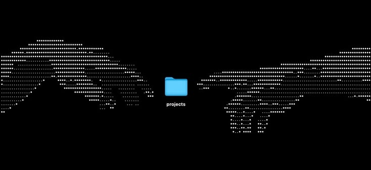
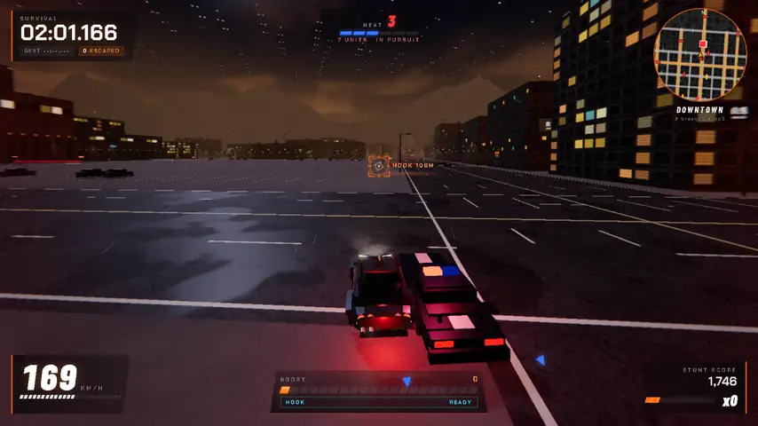
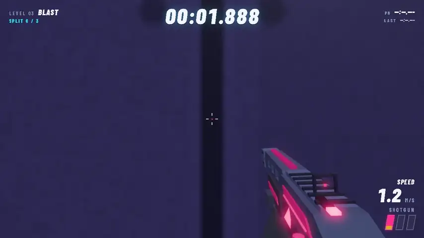

  
  

## Projects

<table>
<tr>
<td width="45%" valign="top"></td>
<td valign="top">

### [Flows](https://github.com/yirasso/flows-mod)

Saved, repeatable AI flows for Claude Code: agents, Node scripts, approvals and a for-each, written in the chat, run with one command and shown step by step in a pane.

</td>
</tr>
<tr>
<td width="45%" valign="top"></td>
<td valign="top">

### [Claudify](https://github.com/yirasso/claudify-mod)

Your project's everyday actions in a band above the Claude Code prompt: start the app, save to GitHub with Undo, pull, build, a knowledge graph and typecheck that follow your work, and your usage limits.

</td>
</tr>
<tr>
<td width="45%" valign="top"></td>
<td valign="top">

### [Frontend Design](https://github.com/yirasso/frontend-design)

Single-file landing page designs — WebGL, scroll-driven motion and real-time audio synthesis. No build step, no framework.

</td>
</tr>
<tr>
<td width="45%" valign="top"></td>
<td valign="top">

### REDLINE//HOOK

A third-person arcade police-pursuit survival game for desktop browsers, built with TypeScript, Three.js and Vite.

</td>
</tr>
<tr>
<td width="45%" valign="top"></td>
<td valign="top">

### PUMP//BEAT

A first-person parkour speedrunning game for desktop browsers, built with HTML5, JavaScript and Three.js.

</td>
</tr>
<tr>
<td width="45%" valign="top"></td>
<td valign="top">

### [Haiky](https://github.com/yirasso/haiky)

[TERMINATED — unmaintained, open to anyone who wants to continue it] An Electron mascot that stands on your Windows taskbar, has weight, and reacts to what Claude Code is doing. It never speaks unprompted.

</td>
</tr>
<tr>
<td width="45%" valign="top"></td>
<td valign="top">

### [NanoMark](https://github.com/yirasso/nano-mark)

A minimal desktop markdown editor whose source and rendered views both look exactly like GitHub. Built with Electron, React and CodeMirror 6.

</td>
</tr>
<tr>
<td width="45%" valign="top"></td>
<td valign="top">

### [HyprCode](https://github.com/yirasso/hyprcode)

[TERMINATED — unmaintained, open to anyone who wants to continue it] An Electron desktop app for running AI coding agent sessions in parallel, under a tiling window manager's laws. Four panes, its own tool runtime, and a first-class theme system.

</td>
</tr>
<tr>
<td width="45%" valign="top"></td>
<td valign="top">

### [TabsTerm](https://github.com/yirasso/tabs-term)

Guitar tablature you write yourself. Play something into your browser, get a tab back, correct it on a grid that cannot fall out of line, and hear it played.

</td>
</tr>
<tr>
<td colspan="2" valign="top">

### [School](https://github.com/yirasso/School)

This repository brings together work developed across two different academic paths: 42 School and Iscte-IUL.

</td>
</tr>
</table>
